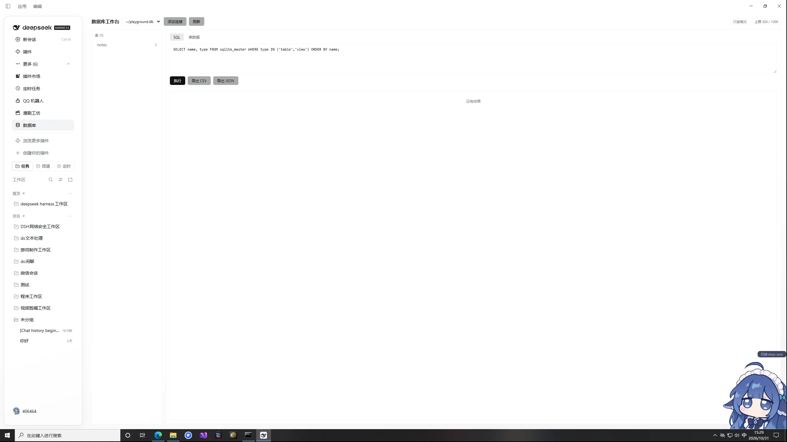

# dsh-db

[](https://www.npmjs.com/package/@406464/dsh-db)
[](https://github.com/406464/dsh-db/actions/workflows/ci.yml)
[](LICENSE)
[](package.json)



A database workbench plugin for [DeepSeek Harness](https://github.com/deepseek-ai/deepseek-harness): SQLite connection manager + SQL editor + data-grid panel + an agent-facing `db` tool — plus the **sqlite backend** that DSH's storage hub documents but does not ship.

Built on Node's built-in `node:sqlite` (`DatabaseSync`): **no native dependencies, no build step, no Electron ABI roulette**.

[中文](README.zh.md) | English

## What you get

| Surface | Contents |
|---|---|
| **Panel** | A "Database" icon in the left sidebar → full-page workbench: connections, table tree, SQL editor, paginated/sortable/filterable data grid, inline cell editing, CSV/JSON export |
| **Agent tool** | One `db` tool with an `action` parameter, so the agent in a session can inspect and query your databases |
| **Storage backend** | Registers as backend `sqlite` on `ctx.storage`, so other plugins can route their `ctx.storageDomain` domains to SQLite |

Panel actions and agent tools call the **same** host methods. One operation, two callers.

## Install

```bash
git clone https://github.com/406464/dsh-db.git
cd dsh-db && npm install && npm test     # self-test, no DSH required
```

Then install it into DSH — `dsh plugin` forwards its arguments to pnpm in the profile directory:

```powershell
# Windows — from npm
& "D:\deepseek harness\resources\runtime\cli\bin\dsh.cmd" plugin --profile desktop add @406464/dsh-db
```

```bash
# macOS desktop
DSH_CLI="/Applications/DeepSeek Harness.app/Contents/Resources/runtime/cli/bin/dsh"
"$DSH_CLI" plugin --profile desktop add @406464/dsh-db
```

Until the npm release lands, install straight from GitHub:

```bash
"$DSH_CLI" plugin --profile desktop add github:406464/dsh-db
```

Or install from a local directory via the Plugins page, or ask the agent to run `install_bundle` on the cloned folder.

**Restart DSH afterwards**: host-side modules load once at startup. If the sidebar entry is missing, check that the bundle is enabled on the Plugins page.

## Configuration

Set these on the plugin row in your profile's `cordis.patch.yml` (the user patch layer survives upgrades):

```yaml
- name: 'dsh-db'
  config:
    root: ~/.dsh/plugin-data/dsh-db   # default: derived from the profile mount point, else ~/.dsh
    defaultLimit: 200
    maxLimit: 5000
    maxRows: 1000
    maxBytes: 262144
    agentDefaultLimit: 50
    allowWrite: false
    allowAttach: false
    allowAddConnection: false
    registerStorageBackend: true
    allowDirs: []
```

Route a domain to SQLite:

```yaml
- name: '@deepseek-ai/dsh-storage'
- name: 'dsh-db'
- name: '@deepseek-ai/dsh-storage-domain'
  config:
    backend: json
    routes:
      mydomain: sqlite
```

## Safety defaults

- **Only registered connections.** A path must sit inside an allowed root (plugin data dir + workspaces + `allowDirs`). Unregistered files are unreachable.
- **Two gates for writes.** `allowWrite` plus an explicit `confirm: true` per call.
- **Statement guard.** Unrecognised leading keywords are rejected; `ATTACH`/`DETACH` off by default; `load_extension` always rejected.
- **Bounded results.** Row-count and byte caps, with `truncated: true` instead of dumping a table into the model context.
- **Loopback-only HTTP.** `/dsh-db/api/*` accepts local requests and POST only.

Errors carry stable codes: `write-disabled`, `confirm-required`, `forbidden-sql`, `path-out-of-scope`, `multi-statement`, `not-found`, `sql-error`.

## How this differs from similar plugins

[`dsh-db-studio`](https://www.npmjs.com/package/dsh-db-studio) already exists on npm (SQLite / PostgreSQL / MySQL, with an in-conversation database tab, a `/db` command, and query history). Different tradeoffs:

| | dsh-db (this project) | dsh-db-studio |
|---|---|---|
| Databases | SQLite only | SQLite + PG + MySQL |
| Dependencies | **zero** (Node's built-in `node:sqlite`) | `pg` + `mysql2` |
| storage-hub sqlite backend | **yes** — other plugins can route domains to SQLite | no |
| In-conversation binding / query history / `/db` | no | yes |
| Writes by default | **off** (`allowWrite: false` + per-call `confirm`) | on |

Pick theirs for company PG/MySQL and conversation-bound querying. Pick this one for a dependency-free local SQLite workbench that also fills the storage hub's sqlite slot.

## Known limits (stated plainly)

- `DatabaseSync` is **synchronous** and runs on the host's main thread. A full-table scan stalls the whole Harness — `node:sqlite` exposes no statement cancellation. Row/byte caps and explicit `LIMIT` are the current mitigation; moving heavy queries to a worker thread is on the roadmap.
- `query` accepts a single statement (use `exec` for batches).
- Connection-table changes made outside the host are picked up via file mtime, but **host code changes need a restart**.

## Development

```bash
npm run check     # syntax-check every file
npm test          # 27 assertion groups: classification, guards, schema, grid, writes, export, storage contract
node test/seed-demo.mjs   # create a playground.db so the panel and tool have something to show
```

## License

MIT
