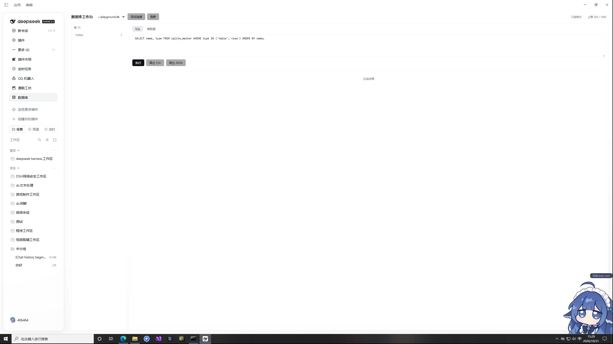

# dsh-db

[](https://www.npmjs.com/package/@406464/dsh-db)
[](https://github.com/406464/dsh-db/actions/workflows/ci.yml)
[](LICENSE)
[](package.json)



DeepSeek Harness 的数据库工作台插件：SQLite 连接管理 + SQL 编辑器 + 数据网格操控面板 + Agent 工具，并为 DSH 的 storage hub 补上官方尚未随包的 **sqlite 后端**。

基于 Node 内置的 `node:sqlite`（`DatabaseSync`）——**零原生依赖、零编译、不跟 Electron ABI 较劲**。

中文 | [English](README.md)

## 它给你三样东西

| 面 | 内容 |
|---|---|
| **操控面板** | 左侧栏一个「数据库」图标 → 整页工作台：连接管理、表树、SQL 编辑器、可分页/排序/过滤的数据网格、单元格编辑、CSV/JSON 导出 |
| **Agent 工具** | 一个 `db` 工具（`action` 参数），让会话里的 Agent 直接查你的库、看 schema、跑写操作 |
| **storage 后端** | 在 `ctx.storage` 上注册名为 `sqlite` 的后端，其它插件可用 `ctx.storageDomain` 把域路由到 SQLite（官方 `dsh-storage-json` 的 README 已经引用了这个后端，但当前 build 没随包） |

面板按钮和 Agent 工具调的是**同一份** Host 方法，不存在两套逻辑。

## 安装

```bash
git clone https://github.com/406464/dsh-db.git
cd dsh-db && npm install && npm test     # 自检，不依赖 DSH
```

在 DSH 里安装（任选其一）：

```powershell
# Windows —— 从 npm
& "D:\deepseek harness\resources\runtime\cli\bin\dsh.cmd" plugin --profile desktop add @406464/dsh-db
```

```bash
# macOS 桌面端
DSH_CLI="/Applications/DeepSeek Harness.app/Contents/Resources/runtime/cli/bin/dsh"
"$DSH_CLI" plugin --profile desktop add @406464/dsh-db
```

还没发 npm 之前，直接从 GitHub 装：

```bash
"$DSH_CLI" plugin --profile desktop add github:406464/dsh-db
```

也可以从本地目录装：插件页 → 从本地目录安装，指向 clone 出来的 `dsh-db` 目录；或直接对 Agent 说「把 G:\path\to\dsh-db 装成插件」。

**装完重启一次 DSH**：宿主侧模块只在启动时加载一次。若侧栏没出现「数据库」，去插件页确认该 bundle 已启用。

## 配置

在 profile 的 `cordis.patch.yml` 里改这一行（用户层配置在升级后保留）：

```yaml
- name: 'dsh-db'
  config:
    root: ~/.dsh/plugin-data/dsh-db   # 默认：从 profile 挂载点反推，反推不到就落 ~/.dsh
    defaultLimit: 200        # 面板/查询默认行数
    maxLimit: 5000           # 单次可请求的上限
    maxRows: 1000            # 硬行数闸
    maxBytes: 262144         # 硬字节闸（超出即 truncated）
    agentDefaultLimit: 50    # Agent 侧默认 limit（省 context）
    allowWrite: false        # 写 / DDL / 网格编辑总开关
    allowAttach: false       # ATTACH / DETACH（可跨文件读写，默认禁）
    allowAddConnection: false # 是否允许 Agent 登记新连接（面板不受此限）
    registerStorageBackend: true  # 关掉就不注册 sqlite 后端
    allowDirs: []            # 额外允许登记/导出的目录（绝对路径）
```

把某个域路由到 SQLite：

```yaml
- name: '@deepseek-ai/dsh-storage'
- name: 'dsh-db'
- name: '@deepseek-ai/dsh-storage-domain'
  config:
    backend: json
    routes:
      mydomain: sqlite
```

## 安全默认

- **只访问已登记的连接**：路径必须落在允许根（插件数据目录 + 各工作区 + `allowDirs`）内，未登记的文件打不开。
- **写操作两道闸**：`allowWrite` 总开关 + 每次调用显式 `confirm: true`。
- **语句白名单起步**：未识别的起始关键字直接拒；`ATTACH`/`DETACH` 默认拒；`load_extension` 永久拒。
- **结果有上限**：行数与字节双闸，超出返回 `truncated: true` 而不是把整个表灌进 context。
- **HTTP 面仅回环**：`/dsh-db/api/*` 只接受本机请求，且只认 POST。

错误统一带稳定 `code`：`write-disabled` / `confirm-required` / `forbidden-sql` / `path-out-of-scope` / `multi-statement` / `not-found` / `sql-error`。

## 和同类插件的区别

npm 上已有 [`dsh-db-studio`](https://www.npmjs.com/package/dsh-db-studio)（SQLite / PostgreSQL / MySQL，带对话内数据库标签、`/db` 指令、查询历史）。两者定位不同，按需要选：

| | dsh-db（本项目） | dsh-db-studio |
|---|---|---|
| 数据库范围 | 只有 SQLite | SQLite + PG + MySQL |
| 依赖 | **零依赖**（Node 内置 `node:sqlite`） | `pg` + `mysql2` |
| storage hub 的 sqlite 后端 | **有**（其它插件可把域路由到 SQLite） | 无 |
| 对话内绑定 / 查询历史 / `/db` 指令 | 无 | 有 |
| 写操作默认 | **关**（`allowWrite: false` + 每次 `confirm`） | 开（`allowWrite: true`） |

要连公司里的 PG/MySQL、要在对话里挂着库随时问，选它。要一个不装任何原生/第三方依赖、并且能给整个 profile 补上 SQLite 存储后端的本地库工具，选这个。

## 已知边界（诚实说明）

- `node:sqlite` 的 `DatabaseSync` 是**同步**的，跑在 Host 主线程。一条扫全表的大查询会卡住整个 Harness——node:sqlite 没有语句取消接口。当前用行数/字节闸 + 建议写 LIMIT 兜底；把重查询挪进 worker 线程在路线图上。
- `query` 只接受单语句（要一次跑多条用 `exec`）。
- 面板与 Agent 并发写连接表时，两侧通过文件 mtime 自动同步；但**宿主代码改动需要重启**才生效。

## 开发

```bash
npm run check     # 全部文件语法检查
npm test          # 27 组断言：语句分类、安全闸、schema、网格、写操作、导出、storage 契约
node test/seed-demo.mjs   # 造一个 playground.db，面板和工具立刻有东西可看
```

## 许可

MIT
